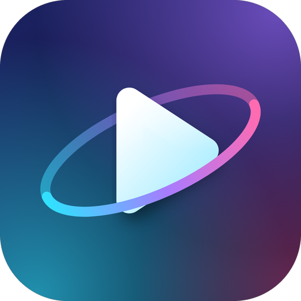

  

<h1 align="center">Aether</h1>

  <em>Il tuo media center per iPhone, fatto a modo tuo.</em> 
  Versione 1.3 rev2 · iOS 17 o successivo · licenza MIT

---

## Cos'è

Aether è un'app per iPhone, scritta da zero in Swift, che mostra e riproduce i contenuti dei **tuoi addon Stremio**: catalogo, ricerca, schede dei titoli, scelta della sorgente e un player completo, tutto in italiano.

Aether **non fornisce nessun contenuto**: sei tu a installare gli addon che vuoi, e sei tu responsabile di ciò che installi. È un progetto indipendente e non ha nessun legame con Stremio o Nuvio.

## Cosa sa fare

- **Home su misura.** Scegli quali sezioni vedere e in che ordine, se le locandine sono verticali o orizzontali e quanto grandi, e se «In evidenza» è una card oppure un'immagine a tutta larghezza con la sfumatura. Puoi anche farti salutare per nome.
- **Theater Mode.** Dalla Home, un'interfaccia a schermo intero in orizzontale in stile cinema: barra laterale, locandine orizzontali, pagina del titolo immersiva e un'introduzione con fascio di proiettore e sipario (si può saltare o spegnere). Anche scelta della sorgente, episodi, impostazioni e player restano nello stile di Theater, con il colore che scegli. Palette, sfondi, angoli e bagliore si regolano in *Impostazioni ▸ Aspetto ▸ Theater Mode*.
- **Un po' di fantasia.** Atmosfere di colore, sfondi (anche in movimento), cornici, angoli e caratteri a scelta, con un'anteprima. E se tocchi più volte il logo in *Altro ▸ Informazioni*… prova.
- **Scopri e Cerca** con filtri per tipo, genere e anno.
- **Libreria** con watchlist, preferiti, cronologia e «Continua a guardare».
- **Scheda del titolo** ricca con la chiave TMDB (cast con foto, produzioni, budget, trailer, titoli simili) e con tutte le sorgenti degli addon, ordinate e spiegate; con la tua chiave **TorBox** vedi subito quali sono già «In cache».
- **Player** con due motori: quello di Apple per MP4 e simili e **MPV** per MKV, AVI e gli altri formati. HDR, sottotitoli degli addon (OpenSubtitles), tracce audio, velocità, gesti, timer di spegnimento, **Salta intro** e **Salta riassunto** per le serie.
- **Download** per guardare senza rete.
- **Trasmettere sul televisore** con AirPlay, Google Cast e DLNA. Il telefono può fare da **ponte** (il televisore non riceve mai la tua chiave TorBox) e **converte al volo gli MKV** per AVPlayer, AirPlay e Cast.
- **Ripristino dei backup da file**, **ordine delle sorgenti per addon** e **pannelli del player a lato** (sottotitoli, audio, sorgenti).
- **Picture in Picture**, quando il file e il sistema lo permettono.

## Come provarla

1. Vai su **[Releases](../../releases)** e scarica `Aether-unsigned.ipa` dell'ultima versione.
2. Il file **non è firmato**: iOS non lo installa così com'è. Firmalo con il tuo Apple ID usando uno strumento come AltStore o Sideloadly (oppure con un tuo certificato).
3. Apri Aether e, in **Altro ▸ Addon**, installa il tuo primo addon (Aether ti propone Cinemeta, il catalogo di base).
4. Facoltativo: in **Impostazioni ▸ Servizi** inserisci la tua chiave TorBox, e TMDB o TheTVDB se vuoi schede più ricche.

Se qualcosa non funziona, in *Impostazioni ▸ Account e dati* puoi attivare un registro diagnostico che resta solo sul tuo telefono e aiuta a capire che cosa è successo.

## Quanto è provata, con onestà

Il codice compila e centinaia di test automatici girano a ogni modifica su macOS. Ma un test automatico non sostituisce un iPhone vero.

- ✅ **Provato su un iPhone** (da chi sviluppa l'app): il player e i suoi tocchi, TorBox con i torrent già in cache, l'aspetto dell'elenco sorgenti, i filtri di Cerca e Scopri.
- 🟡 **Scritto e provato solo in simulatore, non su un iPhone:** le novità della 1.1 e della 1.3 (Theater Mode, ponte e conversione MKV, ripristino da file, scheda del titolo, pannelli del player), Salta intro, le griglie di Libreria e Scopri.
- ⚠️ **Theater Mode non l'ho mai visto su uno schermo:** è controllato solo da test automatici; aspetto e animazioni vanno giudicati a occhio.
- ⚠️ **Mai provato dal vivo:** AirPlay con Apple TV, Google Cast e DLNA verso un televisore vero, Picture in Picture, aspetto di HDR e Dolby Vision, VoiceOver.
- ⚠️ **Picture in Picture:** funziona solo con i file aperti dal motore di Apple (MP4, MOV). Con MKV e AVI (cioè la maggior parte dei file) il motore è MPV, che non lo supporta, e l'app te lo dice. Se usi Aether dentro un contenitore come LiveContainer, iOS può rifiutarlo comunque.

L'elenco completo, funzione per funzione, è nella [documentazione tecnica](docs/00-TECNICO.md).

## Privacy

Nessun account, nessun analytics, nessun dato inviato a un server di Aether. Cronologia, libreria e impostazioni restano sul tuo telefono; gli indirizzi degli addon (che possono contenere chiavi) sono nel Portachiavi di iOS. L'unica eccezione volontaria è «Salta intro», che chiede a IntroDB i tempi dell'episodio (codice IMDb, stagione ed episodio) e si può spegnere in *Impostazioni ▸ Riproduzione*.

## Per chi vuole guardare sotto il cofano

Tutto il resto vive in **[`docs/00-TECNICO.md`](docs/00-TECNICO.md)**: struttura del codice, come compilare e firmare, come comporre l'IPA su GitHub, tabelle dello stato reale, test e sicurezza. Gli altri documenti:

| Documento | Cosa contiene |
|---|---|
| [`docs/00-TECNICO.md`](docs/00-TECNICO.md) | Panoramica tecnica e stato reale funzione per funzione |
| [`docs/09-PERSONALIZZAZIONE.md`](docs/09-PERSONALIZZAZIONE.md) | Personalizzazione della Home e della grafica (1.1) |
| [`docs/10-PONTE-E-CONVERSIONE.md`](docs/10-PONTE-E-CONVERSIONE.md) | Ponte sul telefono e conversione degli MKV |
| [`docs/06-PLAYBACK.md`](docs/06-PLAYBACK.md) | Motori di riproduzione, HDR, Picture in Picture |
| [`docs/07-SERVIZI.md`](docs/07-SERVIZI.md) | TorBox, TMDB, TheTVDB, OpenSubtitles, IntroDB |
| [`docs/04-TESTING.md`](docs/04-TESTING.md) | Test eseguiti e cosa non è stato provato |
| [`docs/02-ARCHITECTURE.md`](docs/02-ARCHITECTURE.md) | Architettura e sicurezza |
| [`docs/release-notes/`](docs/release-notes) | Note di ogni versione |

## Licenza

MIT (vedi [`LICENSE`](LICENSE)). Le librerie di terze parti incluse e i loro obblighi sono elencati in [`NOTICE`](NOTICE) e in [`docs/03-LICENSES.md`](docs/03-LICENSES.md).
